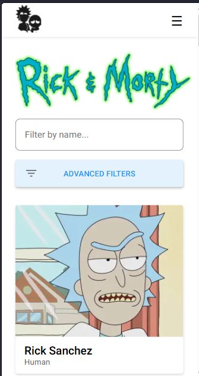
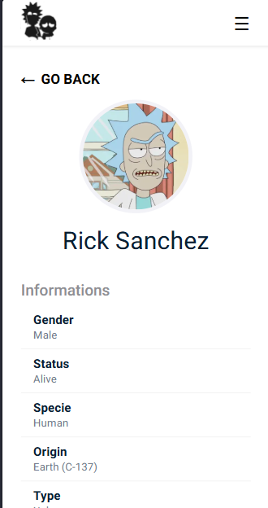
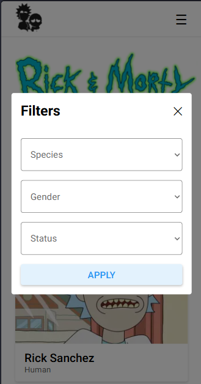

# Rick and Morty Explorer

A mobile-first app to browse the characters, locations and episodes of Rick and Morty,
built with Next.js 15 (App Router), React 19 and TypeScript, using the
[Rick and Morty REST API](https://rickandmortyapi.com/documentation).

## Getting started

Requirements: the Node.js version in `.node-version` (Node 24).

```bash
corepack enable        # or prefix every command with "corepack"
yarn install
yarn dev
```

Then open http://localhost:3000 (best viewed in mobile mode, e.g. 360px wide).

## Scripts

| Command             | Description                        |
| ------------------- | ---------------------------------- |
| `yarn dev`          | Start the development server       |
| `yarn build`        | Build for production               |
| `yarn start`        | Start the production server        |
| `yarn lint`         | Run ESLint                         |
| `yarn format`       | Format the code with Prettier      |
| `yarn format:check` | Check formatting without changing  |
| `yarn typecheck`    | Type-check with TypeScript         |
| `yarn test`         | Run the tests with Vitest          |

## Features

- Characters list with search by name and filters (species, gender, status)
- Locations list with search and filters (type, dimension)
- Episodes list with search by name
- "Load more" pagination on every list
- Detail pages for characters (with their episodes), locations (with residents)
  and episodes (with cast)
- Mobile navigation menu
- "Go back" button on every detail page

## Screenshots

<p>
  
  
  
</p>

## Project structure
## Project structure

- `src/`
  - `app/` – Pages (App Router): each folder is a route
  - `components/` – Reusable UI components (cards, lists, filters, header…)
  - `hooks/` – Custom hooks (`useLoadMore`)
  - `lib/` – API functions (all requests to the Rick and Morty API)
  - `types/` – TypeScript types for the API data
  - `styles/` – Global styles

## Technical decisions

- **Server components for the first load.** Each page fetches its first 20 items
  on the server, so the content is ready when the page arrives.
- **Client components only where needed.** Lists with "Load more", the filters
  and the menu run in the browser because they need state and clicks.
- **A reusable `useLoadMore` hook.** The pagination logic is shared by the
  character, location and episode lists instead of being written three times.
- **Filters stored in the URL** (e.g. `/?name=rick&status=Dead`), so a refresh or a
  shared link keeps the same results. One `FilterBox` component is configured for
  each page.
- **Reusable components:** `CharacterCard` is used on the home page and on the
  location/episode detail pages; `InfoCard` is used for both locations and episodes.
- **Styling with CSS Modules** (no UI library, as required), and the Roboto font
  loaded with `next/font`.
- **Accessibility:** semantic HTML (`header`, `nav`, `main`, `section`, lists),
  `aria-label`/`aria-expanded` on icon buttons, `alt` text on images.

## API notes

- The API returns 20 items per page, so "Load more" loads 20 at a time.
- When no item matches a filter, the API answers with a 404. The app treats this
  as an empty list instead of an error.
- When requesting a single id (e.g. `/character/1,2` vs `/character/1`), the API
  returns an object instead of an array, so the helpers always return an array.

## Tests

Vitest + React Testing Library: components are tested the way a user sees them
(by text and role), and the API helper is tested with a mocked `fetch`.

## What I would improve with more time

- More tests (the `useLoadMore` hook and the filters)
- A CI pipeline (GitHub Actions) running lint, typecheck and tests on every push
- Extract repeated UI into more components (e.g. a shared Load More button)

## Author

Fatemeh Nouri – [LinkedIn](https://linkedin.com/in/fateme-nouri) · [GitHub](https://github.com/NouriFatemeh1999)